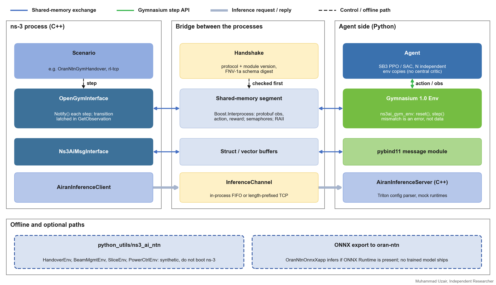
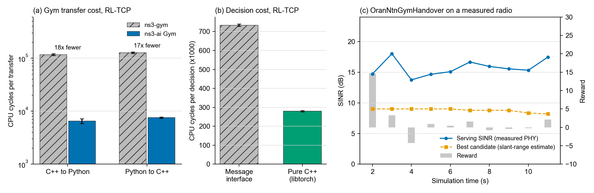

<h1 align="center">ns3-ai-ntn</h1>

<p align="center"><strong>A modernized ns3-ai bridge for ns-3.43: Gymnasium 1.0 over versioned shared memory, an AI-RAN inference contract, and NTN reinforcement-learning tooling</strong></p>

<p align="center">
  <a href="https://www.nsnam.org"></a>
  <a href="https://www.gnu.org/licenses/old-licenses/gpl-2.0.en.html"></a>
  
  
  
  <a href="https://doi.org/10.1109/OJCOMS.2026.3745010"></a>
</p>

<p align="center">
  <a href="https://github.com/Muhammaduazir69/ns3-ntn-toolkit">Toolkit</a>
  &nbsp;·&nbsp;
  <a href="https://muhammaduazir69.github.io/ns3-ntn-toolkit/modules/ns3-ai-ntn/">Docs</a>
  &nbsp;·&nbsp;
  <a href="INSTALL.md">Install</a>
  &nbsp;·&nbsp;
  <a href="#results">Results</a>
  &nbsp;·&nbsp;
  <a href="#examples">Examples</a>
</p>

---

## Why this module

Reinforcement learning against a network simulator fails in two characteristic
ways, and this fork fixes both. First, the agent may never be stepped:
registering a Gymnasium interface without a `Notify()` call site gives a training
loop that runs, converges and learns nothing. Second, the reward may be computed
from state the action has not reached yet, which inverts it. On the original code
a 5 to 15 dB improvement earned -15 while a 15 to 5 dB degradation earned -5, so
the agent was paid more to make the link worse. The fix for the second is
structural: the transition is latched inside `GetObservation`.

The C++ and Python sides share a protobuf schema over shared memory, a contract
that used to be unchecked. The handshake now carries a protocol version, a module
version and an FNV-1a schema digest, so a mismatch is reported instead of being
misread as data. Upstream [ns3-ai](https://github.com/hust-diangroup/ns3-ai) also
crashed on NumPy 2.0, failed to import on Python 3.13 and lost pybind11 symbols
under ns-3.43 link-time optimization; this fork fixes those and 8 other issues.

## System design

<p align="center">
  
</p>

<p align="center"><sub>Two processes and the bridge between them. The handshake is checked before the first step. The Gym path carries protobuf observations, actions and rewards; the message path carries fixed-layout structs and vectors; the AI-RAN inference contract runs over an in-process FIFO or length-prefixed TCP. Dashed boxes are offline or optional. Script: <code>doc/figures/make_ns3_ai_ntn_design.py</code>.</sub></p>

## Results

<p align="center">
  
</p>

<p align="center"><sub>(a) and (b): upstream ns3-ai benchmark on the RL-TCP example, 6 seeds, bars are means over seeds and whiskers the standard deviation across seeds; data in <code>docs/benchmarking/gym-interface-data.m</code> and <code>docs/benchmarking/pure-cpp-data.m</code>. (c): one 12 s run of <code>oran-ntn-gym-handover-example</code> in in-process mode (3 satellites, 2 UEs), parsed from the stored log <code>toolkit-audit-2026-10-06/runs/A6-ai-twin-security/gym-inproc-12s/run.log</code>. Script: <code>doc/figures/make_ns3_ai_ntn_results.py</code>; table: <a href="doc/figures/ns3_ai_ntn_results_summary.csv"><code>ns3_ai_ntn_results_summary.csv</code></a>.</sub></p>

| Measurement | Value | Source |
|---|---:|---|
| C++ to Python transfer, ns3-gym vs ns3-ai Gym | 117,017 vs 6,518 cycles (18x fewer) | upstream benchmark, 6 seeds |
| Python to C++ transfer, ns3-gym vs ns3-ai Gym | 127,148 vs 7,584 cycles (17x fewer) | upstream benchmark, 6 seeds |
| RL decision, message interface vs pure C++ (libtorch) | 733,702 vs 279,648 cycles | upstream benchmark, 6 seeds |
| Gym steps on the measured radio, mean serving SINR | 10 steps, 15.71 dB | 1 run, 12 s |

Panel (c) shows what the environment sees: feature 0, the serving SINR, is
measured off the PHY receive trace; the best-candidate SINR is a free-space
slant-range estimate, and the greedy A3-offset rule keys on it, so the agent
stays on the serving satellite for the whole run. The cycle counts in (a) and (b)
were measured by the upstream ns3-ai authors; they were not re-measured on this
fork.

The Python package's validation gates (PPO against a random policy on
`HandoverEnv`, GAT next-hop accuracy on a 50-node graph) are listed in
[python_utils/README.md](python_utils/README.md); their raw outputs are not
stored in the tree. Rerun with
`python -m ns3_ai_ntn.sb3.train_ppo_handover --total-steps 10000 --seed 0 --out ppo_result.json`.

## Classes

| Class or package | Role | Location |
|---|---|---|
| `OpenGymInterface`, `Ns3AiGymEnv` | Gym interface on the C++ side; `Notify()` per step, transition latched in `GetObservation` | `model/gym-interface/cpp/` |
| `ns3ai_gym_env` | Gymnasium 1.0 environment on the Python side; checks the handshake digest | `model/gym-interface/py/` |
| `Ns3AiMsgInterface` | low-level message interface for fixed-layout structs and vectors, RAII over `managed_shared_memory` | `model/msg-interface/` |
| `AiranInferenceClient`, `AiranInferenceServer` | AI-RAN inference contract, length-prefixed protobuf (`grpc/proto/airan_inference.proto`) | `grpc/cpp/` |
| `InferenceChannel` (in-process, TCP) | pluggable transport; a native grpc++ transport is planned | `grpc/cpp/inference-channel*.h` |
| Triton config parser, `AiranMockRuntime` | parses `config.pbtxt`; deterministic mock runtimes for `beam_index_classifier` and `precoder_csi_to_weights` | `grpc/cpp/`, `grpc/triton/` |
| `ns3_ai_ntn` | Python package: 4 environments, SB3 PPO trainer, PyTorch Geometric GAT, parameter-shared multi-agent wrappers, `ns3gym` shim | `python_utils/ns3_ai_ntn/` |
| `ns3ai_add_pybind_module()` | CMake helper that disables LTO per pybind11 target (the ns-3.43 import failure) | `CMakeLists.txt` |

## Quick start

Inside the toolkit, where the module is present and built:

```bash
./ns3 build ns3ai_apb_gym
cd contrib/ns3-ai-ntn/examples/a-plus-b/use-gym/ && python3 apb.py
# a Gym agent against a measured NR NTN cell (blocks until the Python peer connects)
./ns3 run "oran-ntn-gym-handover-example --gym=1"
```

Standalone, into an existing ns-3.43 tree:

```bash
git clone -b fix/ns3-43-compatibility-and-critical-bugs \
  https://github.com/Muhammaduazir69/ns3-ai.git contrib/ns3-ai-ntn
./ns3 configure --enable-examples --enable-tests
./ns3 build
pip install -e contrib/ns3-ai-ntn/model/gym-interface/py
pip install -e "contrib/ns3-ai-ntn/python_utils[all]"
```

With Docker, prebuilt: `docker run --rm -it uzairdocker69/ns3-ntn-toolkit:latest bash`.

## Examples

Each example directory has its own README. The Python script drives the run and
spawns the matching ns-3 binary.

| Example | CMake targets | What it shows |
|---|---|---|
| [a-plus-b](examples/a-plus-b) | `ns3ai_apb_gym`, `ns3ai_apb_msg_stru`, `ns3ai_apb_msg_vec` | hello world for both interfaces: C++ sends numbers, Python returns the sum |
| [rl-tcp](examples/rl-tcp) | `ns3ai_rltcp_gym`, `ns3ai_rltcp_msg`, `ns3ai_rltcp_purecpp` | DQN congestion control over the Gym or message interface, or pure C++ |
| [rate-control](examples/rate-control) | `ns3ai_ratecontrol_constant`, `ns3ai_ratecontrol_ts` | Wi-Fi rate control (constant, Thompson sampling) |
| [lte-cqi](examples/lte-cqi) | `ns3ai_ltecqi_msg`, `ns3ai_ltecqi_purecpp` | online LSTM CQI prediction in an LTE scheduler |
| [multi-bss](examples/multi-bss) | `ns3ai_multibss` | multi-BSS Wi-Fi channel access with a VR traffic app |
| `oran-ntn-gym-handover-example` (in `oran-ntn`) | | `OranNtnGymHandover` on a measured NR NTN radio; `--gym=1` uses this bridge |

## Tests

```bash
# C++ AI-RAN inference contract: codec round trips, in-process and TCP channels,
# Triton config parsing, failure modes, an in-simulator workload (10 cases)
./test.py -s oran-ntn-airan-inference

# Python NTN extensions (11 tests: environments, GNN, SB3)
cd contrib/ns3-ai-ntn/python_utils && pip install -e .[test] && pytest tests/ -v
```

## Dependencies

Boost 1.70 or newer (interprocess, program_options), pybind11 2.13 (CMake
package), protobuf, Python 3.10 to 3.13, NumPy 2, Gymnasium 1.0. Optional:
Stable-Baselines3 and PyTorch Geometric for `python_utils`; a `libtorch` or
`libtensorflow` distribution in `model/` enables the pure-C++ examples, which are
skipped otherwise. See [INSTALL.md](INSTALL.md).

## Honest scope

- The four NTN environments in `python_utils/ns3_ai_ntn` (`HandoverEnv`,
  `BeamMgmtEnv`, `SliceEnv`, `PowerCtrlEnv`) are synthetic: they do not boot ns-3
  and carry no measured KPI. They exercise the RL tooling. The environment that
  runs on a measured radio is `OranNtnGymHandover` in `oran-ntn`.
- The bundled trainers are single-agent PPO and SAC over N independent environment
  copies. The MAPPO and MASAC wrappers share parameters but have no centralized
  critic and no joint observation; the agents cannot see or affect each other.
- The inference contract mirrors the wire format a grpc++ server would expose,
  but the native grpc++ transport is not implemented yet; the runtimes behind it
  are deterministic mocks, not trained models.
- 3GPP TR 38.843 AI/ML lifecycle management is not implemented.

## Citation

Please cite the toolkit article, and the original ns3-ai paper for the bridge:

> M. Uzair et al., "ns3-ntn-toolkit: An integrated ns-3 platform for 6G
> non-terrestrial networks," *IEEE Open Journal of the Communications Society*,
> 2026, doi: [10.1109/OJCOMS.2026.3745010](https://doi.org/10.1109/OJCOMS.2026.3745010).

```bibtex
@article{uzair2026ns3ntntoolkit,
  author  = {Uzair, Muhammad and others},
  title   = {ns3-ntn-toolkit: An Integrated ns-3 Platform for 6G Non-Terrestrial Networks},
  journal = {IEEE Open Journal of the Communications Society},
  year    = {2026},
  doi     = {10.1109/OJCOMS.2026.3745010}
}
@inproceedings{yin2020ns3ai,
  title     = {{ns3-ai}: Fostering Artificial Intelligence Algorithms for Networking Research},
  author    = {Yin, Hao and others},
  booktitle = {Proc. Workshop on ns-3 (WNS3)},
  year      = {2020}
}
```

## License

GPL-2.0-only, matching ns-3 and upstream ns3-ai.

## Contact

**Muhammad Uzair**, Independent Researcher.
Email [muhammaduzairr69@gmail.com](mailto:muhammaduzairr69@gmail.com),
ORCID [0009-0002-4104-2680](https://orcid.org/0009-0002-4104-2680).
Part of the [ns3-ntn-toolkit](https://github.com/Muhammaduazir69/ns3-ntn-toolkit),
mirrored on [GitLab](https://gitlab.com/ns3-ntn-toolkit).
